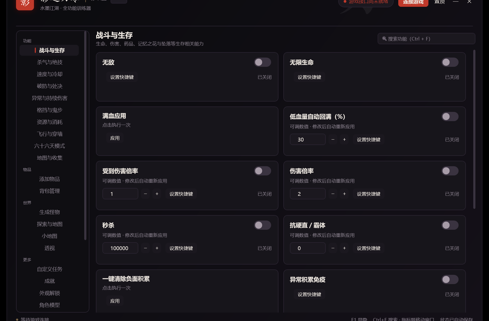

# 影之刃零 修改器（Phantom Blade Zero Trainer）

《影之刃零 / Phantom Blade Zero》单人模式的外部修改器，C# / WPF 实现，水墨暗色 + 朱砂红界面。

作者：B站账号 **KuugaOOO**。其余账号发布的同名修改器均为盗版。

**76 项功能开关 + 3000 余条可操作条目**：10 个功能分类、14 个工具页、2 个游戏内悬浮层。
**默认以管理员权限启动**，游戏无论用普通权限还是管理员权限打开都能连上；启动时系统会弹一次 UAC，点「是」即可。



## 下载

**[⬇ 下载 PBZTrainer-v1.0.8-win-x64.exe](https://github.com/Kuuga-913/pzb-trainer/releases/download/v1.0.8/PBZTrainer-v1.0.8-win-x64.exe)**（单文件 71 MB，Windows x64）

| 项目 | 说明 |
|---|---|
| 版本 | **v1.0.8**（当前推荐，附件已上传） |
| 体积 | 71,025,450 字节（约 67.7 MiB） |
| 使用 | 下载 → 双击 → UAC 点「是」→ 先开游戏、进存档后即为「● 游戏已就绪」 |
| 自带 | .NET 8 运行时，免安装，不写注册表、不留服务 |

也可以到 [Releases 列表](https://github.com/Kuuga-913/pzb-trainer/releases) 选任意版本（v1.0.0 ~ v1.0.8 均有附件）。

> **关于 v1.0.9 / v1.0.10**：这两个版本的说明页已发布，但成品附件尚未上传成功（上传链路问题），
> 因此**请先使用 v1.0.8**。相比 v1.0.8，v1.0.10 的改动是：助战预设移除「秒杀」、生成页新增
> 「还原全部修改」按钮、诊断页新增「当前已开启的功能」清单——都属于辅助改进，不影响 v1.0.8 的正常使用。
> 附件补齐后会把这里换成新版。
>
> 注意链接末尾带 `/latest` 是「只显示最新版」的单页；带 `/releases` 才是完整列表。

## 功能总览

### 一、76 项功能开关（按分类浏览）

| 分类 | 项数 | 内容 |
|---|---:|---|
| 战斗与生存 | 16 | 无敌、无限生命、满血、低血量自动回满、受伤 / 伤害倍率、秒杀、抗硬直、清除负面积累、异常免疫、药品、记忆之花、意识尘埃、坠落免疫 |
| 异常与持续伤害 | 16 | 出血 / 灼烧 / 中毒 / 冰冻 / 感电 / 血爆的积累倍率、增幅、持续时长、触发概率 |
| 杀气与绝技 | 9 | 无限杀气、杀气回复、消耗减免、精纯杀气、影之武装资源 |
| 破防与处决 | 7 | 快速破防、敌方杀气、破防持续、处决阈值、玩家不被破防 |
| 速度与冷却 | 6 | 移动 / 攻击 / 游戏 / 敌人速度、技能冷却、武装切换冷却 |
| 格挡与鬼步 | 6 | 完美格挡窗口、招架判定、自动格挡、自动闪避、闪避无敌窗口、自动 QTE |
| 飞行与穿墙 | 5 | 飞天、飞行速度、穿墙移动、安全返回、高度调整 |
| 资源与消耗 | 4 | 药剂不减、补满药剂、消耗品不减、养成货币倍率 |
| 六十六天模式 | 4 | 死亡不扣次数、周目、难度、剩余次数 |
| 地图与收集 | 3 | 区域铃铛、全域地图解锁、记忆之花补齐 |

按交互类型分：开关型 19 项、数值型 48 项（可输入或 ± 微调）、执行型 9 项。

### 二、目录类工具（2400 余条目）

| 工具 | 规模 | 能做什么 |
|---|---|---|
| 添加物品 | 880+ 项 | 按名称 / 分类 / 代号搜索，指定数量添加（1~9999），显示已持有数 |
| 背包管理 | 550+ 项 | 改持有数量、删除整条记录（带确认，不可撤销） |
| 生成怪物 | 177 种 | 数量 1~10、距离、敌 / 友军；「助战预设」开关 + 「还原全部修改」（关掉仍虚高时点它） |
| 探索与地图 | 179 处 | 一键前往；也可记录当前位置随时传回 |
| 一键全收集 | 687 项 | 九类收集 538、所有任务 74、BOSS 战绩 75，外加地图探索；只补缺失项、逐项回读、结束给结果弹窗 |

### 三、任务 / 成就 / 外观 / 招式

| 工具 | 规模 | 能做什么 |
|---|---|---|
| 自定义任务 | 80 项 | 读取全部任务并显示状态（未接取 / 进行中 / 已完成），可标记完成或重置 |
| 成就 | 66 项 | 点亮或取消成就，显示「已点亮 / 未点亮」 |
| 外观解锁 | 9 套 | 解锁服装外观，解锁后到游戏内外观界面切换 |
| 角色模型 | 429 个 | 把角色替换成首领 / NPC 模型，随时「还原默认」 |
| 技能释放 | 1500+ 条 | 直接释放一次攻击技能（被动与配对处决不可单独释放） |
| 技能连段 | 队列 30 步 | 把招式排成队列依次释放，可设步骤间隔、随时停止 |
| BOSS 招式 | 首领战内 | 播放首领招式（需锁定首领时才有目录） |
| 武器状态 | 当前武器 | 调整当前武器的能力参数，断开后自动还原 |
| 资源设置 | 107 项 | 直接设置铸造金属、琥珀、货币等养成资源数量 |
| 角色属性 | 223 项 | 直接改写等级 / 生命 / 伤害与抗性等属性数值（绝对值） |
| 连接诊断 | — | 一键收集环境、就绪状态与 12 个目录的读取结果，可复制 / 保存发给作者 |

### 四、游戏内悬浮层

- **小地图**：雷达式，中心是玩家（箭头随朝向旋转），周围标出铃铛（金）、收集点（青）、挑战（紫）、敌人（红，超出范围贴边显示）；可点击标记直接传送。
- **透视**：按类型勾选敌人 / 首领 / NPC / 宝箱 / 可拾取 / 可交互，画方框与「名称 + 距离」标签，左上角常驻目标计数；150ms 拉帧 + 逐帧插值，移动时不抖。

两个悬浮层都是点击穿透、不抢焦点，切页签不会关闭；修改器窗口在前台时自动隐藏。

## 快速开始

1. 先启动游戏，进入存档、能自由行动。
2. 双击 `PBZTrainer.exe`（会弹一次 UAC，点「是」），等右上角变成「● 游戏已就绪」。
3. 左侧是分组导航（功能 / 物品 / 世界 / 更多 / 自动化），点分组标题可展开或收起；工具页都在后面四组里（任务、成就、外观、模型、技能、招式、资源在「更多」）。

快捷键：`F1` 显示隐藏窗口、`Ctrl+F` 搜索；每张功能卡都能绑全局热键（游戏在前台也生效）。
窗口可拖动标题栏移动，右上角「置顶 / 最小化 / 关闭」。

## 构建

需要 .NET 8 SDK（Windows）：

```bat
dotnet publish src\PBZTrainer\PBZTrainer.csproj -c Release -r win-x64 --self-contained true ^
  -p:PublishSingleFile=true -p:IncludeNativeLibrariesForSelfExtract=true ^
  -p:EnableCompressionInSingleFile=true -p:DebugType=none -o out
```

产物 `out\PBZTrainer.exe` 约 66 MB，单文件、免安装。

## 目录结构

```
src/PBZTrainer/
  Services/
    Injector.cs        定位游戏进程、加载运行时、解析运行路径
    BridgeClient.cs    命名管道客户端：帧收发、握手、能力轮询
    BridgeCommands.cs  完整指令集（目录 / 物品 / 生成 / 传送 / 全收集 / 小地图 / 透视）
    BridgeGate.cs      解除功能限制（仅改游戏进程内存）
    HotkeyService.cs   全局热键（低级键盘钩子）
    StateStore.cs      状态持久化（字段与原版 trainer_state.json 兼容）
  Views/
    MainWindow.xaml    主界面：左侧分组导航 + 右侧功能卡片
    CatalogView.cs     通用目录浏览器（物品 / 背包 / 怪物 / 地点）
    ActionListView.cs  通用动作页（任务 / 成就 / 外观 / 模型 / 技能 / 招式 / 资源 / 属性）
    SkillChainView.cs  技能连段编排（队列 + 依次释放）
    CompletionView.cs  一键全收集（进度 + 结果弹窗）
    OverlayService.cs  小地图 / 透视的驱动与轮询
    OverlayWindows.cs  贴在游戏画面上的透明悬浮层
    EspView.cs / MinimapView.cs / UiKit.cs
  Models/              功能清单解析、状态模型、id→中文名映射
  Data/PBZFeatures.json 功能表（76 项：id / 标题 / 分类 / 类型 / 默认值）
```

## 技术说明

### 通信协议

命名管道 `\\.\pipe\ChuwuPBZ_v1_<游戏PID>`，每帧 = 4 字节小端长度 + UTF-8 JSON；每个请求自动附加 `requestId` / `session` / `clientPid`，响应带回同一个 `session`。

常用指令：

| 指令 | 说明 |
|---|---|
| `hello` / `capabilities` | 握手与能力（76 项状态、角色、地图、坐标） |
| `feature{id,enabled,value}` | 开关某一项功能，`value` 为数值型功能的参数 |
| `collection_step{job}` | 收集类功能的分步执行 |
| `catalog{type}` | 目录：`items` / `inventory` / `enemies` / `locations` / `bells` / `markers` / `dead_enemies` |
| `grant_items{ids,count}` / `inventory_change{id,snapshot,delete,value}` | 添加物品 / 改数量或删除 |
| `spawn{id,count,distance,friendly}` + `spawn_status{batch}` | 生成怪物 |
| `position` / `teleport{world,position}` / `collection_locate{id,travel}` | 位置读取与传送 |
| `completion.plan/begin/step/cancel` | 一键全收集（`job` 是数字，必须原样回传） |
| `minimap.configure/frame/travel_target` | 小地图（帧里含玩家 uv、标记 uv、朝向、层数） |
| `esp.configure/frame/status` | 透视（帧里含 `left/top/right/bottom/label` 屏幕坐标） |

### 进程交互

与游戏的交互走标准远程线程方式：`OpenProcess` + `VirtualAllocEx` + `WriteProcessMemory` + `CreateRemoteThread`。

「添加物品 / 生成怪物 / 一键全收集」这几项在游戏侧带功能校验，程序在连接时会把该判定入口在游戏进程内存里改成恒真——只改内存、不动磁盘文件，游戏重启后重新生效一次即可；若运行环境不匹配，会先校验字节特征再决定是否修改，不匹配就跳过并在日志里说明。

### 界面实现要点

- 无边框窗口用 `WindowStyle=None` + `AllowsTransparency`；拖动区域必须是 `Background="Transparent"` 的容器（`null` 背景不参与命中测试）。
- 卡片开关用 `IsChecked` 双向绑定 + `PropertyChanged`，而不是 `Click`（`Click` 不会被键盘 / UIA 触发）。
- 悬浮层是 `Topmost` + `WS_EX_TRANSPARENT` 的透明窗，按游戏客户区物理像素定位、内容做 `1/dpi` 缩放，使 1 个布局单位等于 1 物理像素；修改器窗口在前台时自动隐藏。
- 透视用「150ms 拉帧 + 每帧向目标位置插值 + 元素按 id 复用」，避免位置跳变。

## 免责声明

- 仅用于**单人离线**模式，请勿用于联机、排行榜或任何涉及其他玩家的场景。
- 会写存档的功能（添加物品 / 改数量 / 删除 / 一键全收集）关闭程序后不会撤销，**使用前请自行备份存档**。
- 本项目与游戏开发商、发行商无任何关联，未获其背书或授权；游戏名称与游戏内文本的权利归其各自权利人所有。
- 使用本工具产生的一切后果由使用者自行承担。

## License

代码以 MIT 协议开源，详见 [LICENSE](LICENSE)。第三方内容不在授权范围内，见 [NOTICE.md](NOTICE.md)。
